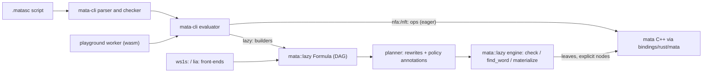
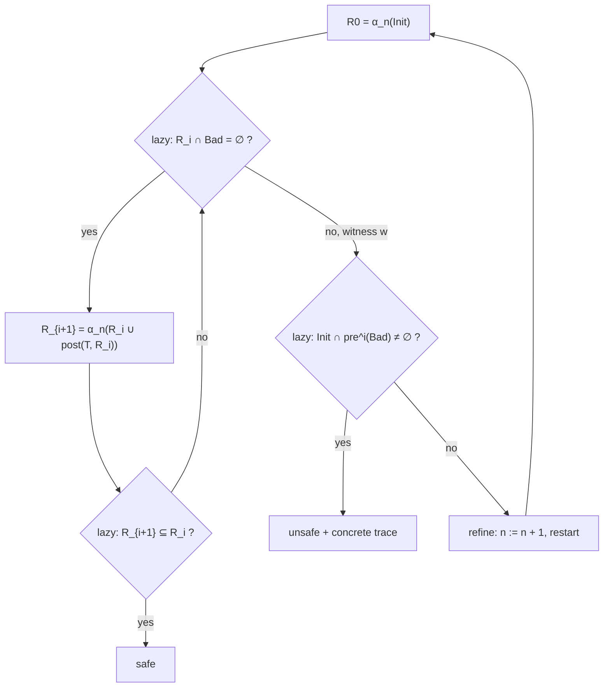

# Lazy automata operations: use cases and integration (design sketch)

This is a working design for later implementation sessions. It builds on the lazy Boolean and relational engine from
[PR #1041](https://github.com/VeriFIT/mata/pull/1041), submitted as `lazymat` (`bindings/rust/lazymat`) and renamed
here to `mata-lazy` / `mata::lazy` (see [Naming and packaging](#naming-and-packaging)). It covers four use cases
and the features they need:

1. regular model checking (RMC) loops with a length abstraction,
2. WS1S and LIA decision procedures built from lazy operations,
3. lazy operations in Mata Script and in the website playground,
4. per-node lazy/eager strategies and preprocessing passes over the operation tree.

Every section separates what exists, with file and symbol references, from what is proposed. Points that need the
user's decision are under [Open questions](#open-questions). The milestone list near the end gives the order to
implement in. Each milestone is one PR.

## Starting point (2026-11-23)

| Piece                            | State                                                                                                                                                                                                                                                                                                                                                                                                 |
| -------------------------------- | ----------------------------------------------------------------------------------------------------------------------------------------------------------------------------------------------------------------------------------------------------------------------------------------------------------------------------------------------------------------------------------------------------- |
| `lazymat` (PR #1041)             | Open, not merged into `devel`, author @tmokenc. Available locally as `lazymat@pr-1029`.                                                                                                                                                                                                                                                                                                               |
| `lazymat` formula nodes          | `Leaf`, `Union`, `Intersection`, `Complement`, `Identity`, `Project`, `Sync` (`sync_product`, `compose[_on]`, `post_image`, `pre_image`), `Explicit` (`src/formula.rs`). There is no concatenation, star, reverse, determinize or minimize node.                                                                                                                                                      |
| `lazymat` queries                | `is_empty`, `find_word`, `check(term, &Options) -> Outcome{witness, stats}`, and `materialize -> mata::nft::Nft`. Inclusion, universality, equivalence and membership are written as emptiness by the caller (`examples/lazy_inclusion.rs`).                                                                                                                                                          |
| `lazymat` knobs                  | Per query (`src/options.rs`): `alphabet`, `tape_alphabet`, `explicit(term)`, `max_states`, `time_limit`, `subsumption`, `antichain`, `cache_budget`. Per node: only `ExplicitOptions{max_states}`. An explicit node that goes over its budget falls back to lazy (`Op::Transparent`).                                                                                                                 |
| `lazymat` internal preprocessing | `engine/exec.rs` `Rewriter::decide` pushes complements down (De Morgan), fuses `op(id A, id B)`, folds projections, builds diagonals, and removes duplicate operands of `op(X, X)`. `Emitter` uses `Cost{depth, log_states}`: it puts the cheaper intersection operand on the left and flattens and sorts unions. `Node` is `pub(crate)`, so no pass outside the crate can read or rewrite a formula. |
| `lazymat` search                 | Depth-first (`Engine::find_accepting`, `engine/mod.rs`). The witness is the first one found, not the shortest. There is no depth or length bound.                                                                                                                                                                                                                                                     |
| `lazymat` statistics             | `Stats{explored, pruned, macrostates, explicit: Vec<Materialized>, dropped}`. Nothing is reported per node, apart from explicit nodes.                                                                                                                                                                                                                                                                |
| `lazymat` RMC example            | `examples/model_checking.rs`: the one-shot proof rule with an inductive invariant (CONCUR 2024). It is not a fixpoint loop and has no abstraction or refinement.                                                                                                                                                                                                                                      |
| Tape semantics                   | Lock step: one symbol per tape per step, with `EPSILON` as padding. This is exact for length-preserving relations (RMC) and for synchronous encodings (WS1S, LIA). It is **not** Mata's asynchronous NFT epsilon alignment, so `lazy:compose` and `nft:compose` can differ on transducers that do not preserve length.                                                                                |
| Mata Script (`mata-cli`)         | Strict and eager: one application is one library call (`docs/src/script-language.md`, design principle 2). Loops exist behind `(set-option :loops-and-recursion true)`. The spec already contains an RMC fixpoint loop ("Loops and recursion"). `mata-cli` does not depend on `lazymat`. There are no limits apart from the call depth (`eval::MAX_DEPTH`).                                           |
| Mata Script optimizer            | `optimize.rs`: the `nfa:language-empty?` ∘ `nfa:intersection` peephole becomes `is_disjoint_from`, plus dead definitions, last-use moves and memoisation. It does not reorder operands or choose between lazy and eager.                                                                                                                                                                              |
| Playground (`site/playground`)   | A separate C++/embind engine (`bindings/wasm/playground.cc`): one fixed operation on at most two automata (`regex` or `.mata` text), with a 20 s worker timeout. It does not run Mata Script. `mata-cli` compiles to `wasm32-unknown-emscripten` (the `code-quality.yml` `run-tests-rust-wasm` job), but the site does not ship it.                                                                   |
| `.mata` format                   | NFAs, NFTs (`@NFT-explicit`, `%Levels`) and bit-vector NFAs (`@NFA-bits`). There are no NFTs over bit vectors.                                                                                                                                                                                                                                                                                        |
| WS1S, LIA                        | No code. `examples/notebooks/example-01-ws1s-formulae.ipynb` builds one WS1S formula eagerly by hand, with hand-written atom automata and `"010"`-style track strings.                                                                                                                                                                                                                                |

The table above describes PR #1041 as submitted, so it keeps the name `lazymat`. The rest of this document uses the
new names.

## Progress (2026-11-24)

- **M0 done.** PR #1107 (superseding #1041) is merged: the engine is the crate `mata-lazy`, re-exported as
  `mata::lazy` by the `lazy` feature of `mata`, with the Mata adapters in `mata`.
- **PR #1122 (open)**: the crate `mata-logic` (`mata::logic`), the connectives of a `Logic` over atoms that are
  automata over bits (`and`, `or`, `not`, `implies`, `iff`, `exists`, `forall`, `model`, `counterexample`), with
  `Padding::Zero` (WS1S, naturals) and `Padding::Sign` (LIA). It also adds `Formula::pad_closure` to `mata-lazy`
  (the `pad_closure` of M1), which `exists` uses. A formula without free variables is still decided when it is
  built.
- The LIA atoms and SMT-LIB front-end (M5) are given to a colleague, with a separate specification. The WS1S
  front-end (M4) is not started.
- **Padding is a node of the engine, not a composition.** A step of `mata-lazy` counts even when every kept tape
  reads padding: after `project`, a step that only the dropped tape needed is still a step. So a closure under
  padding cannot be written as a relation `(w, w·0ᵏ)` composed with the projection; the first version of `exists`
  materialised the projection and closed it explicitly, and was replaced by the node.

## Naming and packaging

Decided: the lazy engine is part of Mata under the names `mata-lazy` (crate) and `mata::lazy` (Rust path). Typing
`mata` must show everything Mata offers, the lazy variant included.

| Layer            | Name                                                                                         |
| ---------------- | -------------------------------------------------------------------------------------------- |
| Cargo package    | `mata-lazy`, in `bindings/rust/mata-lazy` (was `bindings/rust/lazymat`), library `mata_lazy` |
| Rust path        | `mata::lazy::{Formula, Term, Options, Automaton, …}`, re-exported from the `mata` crate      |
| Mata Script      | `lazy:` namespace (`lazy:intersection`, `lazy:empty?`, …), next to `nfa:` and `nft:`         |
| `mata` command   | `mata lazy <op> files…`, next to the direct commands `mata nfa`, `mata nft`, `mata strings`  |
| C++, Python      | none; `mata::lazy` (C++) and `libmata.lazy` (Python) are reserved for bindings, if ever      |
| Logic front-ends | the same rule: crate `mata-logic`, path `mata::logic::{ws1s, lia}`, script `ws1s:` / `lia:`  |

**Dependency cycle.** `lazymat` depends on the `mata` crate for its Mata leaves (`src/mata.rs`: `Automaton` for
`Nfa`/`Nft`, `materialize -> Nft`). So `mata` cannot simply re-export `mata-lazy`. Split by backend:

- `mata-lazy` holds the backend-neutral engine: formulas, the `Automaton` trait, options, statistics, and the
  `regex` and `rustfst` backends. It does **not** depend on `mata` or `mata-sys`. This keeps PR #1041's reason for
  existing as a separate crate: it builds without a C++ toolchain, on tier-1 targets and `wasm32-unknown-unknown`.
- The `mata` crate gets an optional dependency on `mata-lazy` behind a Cargo feature `lazy` (default on), with
  `pub mod lazy { pub use mata_lazy::*; … }`. The module also holds the Mata adapters moved from `src/mata.rs`:
  `impl mata_lazy::Automaton for Nfa / Nft` (allowed by the orphan rule, since `Nfa` is local to `mata`) and
  `materialize`.
- `materialize` currently fills an `Nft` from an internal leaf (`fill`). `mata-lazy` therefore needs a public,
  backend-neutral export, for example `Formula::explore(term, &Options) -> Explored{states, initial, finals, moves}`.
  `mata::lazy::materialize` converts that to an `Nft` or `Nfa`. Other backends can then materialise too.
- Users of pure-Rust backends depend on `mata-lazy` directly. Everyone else uses `mata::lazy`.
- Most of lazymat's tests and examples need the `mata` feature (`required-features = ["mata"]` in its
  `Cargo.toml`). Move those to `bindings/rust/mata/tests` and `examples`, and keep the `regex` tests and the fuzz
  crate in `mata-lazy`. A dev-dependency `mata-lazy → mata` would compile two copies of `mata-lazy`, and the
  `Automaton` impls would not match the trait in the second copy.

Whether the rename happens inside PR #1041 or in the first follow-up PR is for the PR author and maintainers to agree
on (M0).

## Architecture



- `mata::lazy` stays a library with no knowledge of scripts. `mata-cli` maps script values to `mata::lazy` terms.
- The logic front-ends (WS1S, LIA) compile formulas into `mata::lazy` terms and do not call the engine themselves.
- The planner sits between a formula and a query: rewrites inside `mata-lazy`, plus annotations supplied from outside
  (see [Strategies](#strategies-and-preprocessing)).

## Operations to support (all layers)

The request lists intersection, union, complement, inclusion, membership, projection, composition and more. They
map to `mata::lazy` as follows. "New" means the operation has to be added.

| Operation                   | `mata::lazy`                                              | Proposed script name                                    |
| --------------------------- | --------------------------------------------------------- | ------------------------------------------------------- |
| leaf from Nfa/Nft value     | `leaf`, `leaf_over`                                       | `lazy:leaf a [:alphabet …]`                             |
| union / intersection        | `union`, `intersection` (equal arity)                     | `lazy:union`, `lazy:intersection` (n-ary, folded)       |
| complement                  | `complement` (over tape alphabets)                        | `lazy:complement`                                       |
| identity                    | `identity` (arity 1 → 2)                                  | `lazy:identity`                                         |
| projection                  | `project(t, &[keep…])`                                    | `lazy:project t (list 0 2)`; `lazy:project-out t i`     |
| synchronised product / join | `sync_product(l, r, pairs, layout)`                       | `lazy:sync-product`                                     |
| composition                 | `compose`, `compose_on`                                   | `lazy:compose`, `lazy:compose-on`                       |
| image / pre-image           | `post_image`, `pre_image`                                 | `lazy:post-image`, `lazy:pre-image`                     |
| make eager                  | `explicit`, `explicit_with`                               | `lazy:explicit t [:max-states n] [:reduce …]`           |
| emptiness / witness         | `is_empty`, `find_word`, `check`                          | `lazy:empty?`, `lazy:find-word`, `witness` special form |
| inclusion / equivalence     | emptiness of `A ∩ ¬B` (both directions)                   | `lazy:included?`, `lazy:equivalent?`                    |
| universality                | emptiness of `¬A`                                         | `lazy:universal?`                                       |
| membership                  | emptiness of `A ∩ leaf(w)` (a tuple of words for arity n) | `lazy:in-language? t w`                                 |
| materialise                 | `materialize -> Nft`                                      | `lazy:materialize t` (`Nfa` when the arity is 1)        |
| cylindrification (new)      | none; a special case of `sync_product` with Σ\*           | `lazy:insert-tape t i`                                  |
| pad closure (#1122)         | `pad_closure(t, Pad::Step(s) \| Pad::Last)`               | `lazy:pad-closure t :step s` / `:last`                  |
| all states final (new)      | none                                                      | `lazy:prefixes t`                                       |
| length bound (new)          | none                                                      | `:max-length n` on queries                              |
| per-node statistics (new)   | only `Stats.explicit`                                     | `lazy:stats` record, `:explain true`                    |

Queries take the `mata::lazy` options as keywords: `:max-states`, `:time-limit`, `:cache-budget`, `:antichain`,
`:subsumption`, `:alphabet`, `:max-length` (new), `:plan` (new, see [Strategies](#strategies-and-preprocessing)).

## Use case 1: regular model checking loop

### Problem

Configurations are words. `Init` and `Bad` are NFAs and `T` is a length-preserving two-tape transducer. The question
is whether `post*(Init) ∩ Bad = ∅`. The running example is token passing:

- Σ = {t, n}, `Init = t n*`.
- `T = n* (t n → n t) n*`: the token moves one position to the right.
- `Bad = Σ* \ n* t n*`: no token, or more than one.

Further examples to add: Burns' and Dijkstra's mutual exclusion, and the CONCUR 2024 example that is already in
`examples/model_checking.rs`.

### Loop (abstract RMC, Bouajjani, Habermehl, Vojnar, CAV 2004)



Which steps are lazy and which eager. This is the motivating example for mixing the two:

| Step                                   | Mode  | Why                                                                                                                               |
| -------------------------------------- | ----- | --------------------------------------------------------------------------------------------------------------------------------- |
| `R_i ∩ Bad = ∅`                        | lazy  | Only a witness or emptiness is needed, and it stops early.                                                                        |
| `post(T, R_i)`                         | eager | α_n needs an explicit automaton. Use `lazy:materialize` of `post_image`, or `nft:apply`; which is faster is a benchmark question. |
| α_n                                    | eager | A quotient of an explicit automaton.                                                                                              |
| `R_{i+1} ⊆ R_i`                        | lazy  | Inclusion with antichains. The `ExplicitCache` of R_i is reused across rounds when the alphabets stay the same.                   |
| `Init ∩ pre(T, …pre(T, Bad))`, i times | lazy  | A chain of i compositions that is never built. This is where the lazy approach should win the most.                               |

### Length abstraction: both variants

Decided: implement both. The finite-length abstraction from ARMC (B) is the one intended for the RMC loop. Bounded
exploration (A), "make all states final and search to a length limit", is a query option for bug finding and as a
cheap first pass.

- **(B) Finite-length abstraction α_n from ARMC (primary).** Two states are merged when their forward languages of
  words of length ≤ n are equal. The "all states final" variant compares the trace languages of length ≤ n instead.
  This is an eager operation on an explicit NFA, proposed in Mata (C++, `src/nfa/`) as
  `nfa:collapse-by-length a :length n`, with the keywords
  - `:languages "words"` or `"traces"` (trace languages: all states final), and
  - `:direction "forward"` or `"backward"`.

  The refinement is n := n + 1, or, as in the paper, an abstraction refined by the spurious counterexample.

- **(A) Bounded exploration.** Make every state of the configuration automaton final, which gives the prefixes of
  configurations. Search the lazy product to depth `L` only. The query answers one of three ways: a witness (a real
  error of an instance of size ≤ `L`), `empty` (the search finished before depth `L`), or `empty-up-to L`. Needed in
  `mata-lazy`:
  - `Options::max_length(L)`: a depth counter in the depth-first search (`find_accepting`, stored per `Step`), and a
    new outcome `Outcome::Bounded{length}`. Breadth-first order would give shortest witnesses; consider it as a
    second search order.
  - `prefixes(t)` (all states final). On a leaf this is structural and cheap. On an inner lazy node, "all states
    final" is not the same as the prefix closure of the language, because it accepts dead macrostates too. It is
    exact only over trimmed nodes (`Leaf::build` trims leaves; explicit nodes are trimmed), so define it on leaves
    and explicit nodes, and reject it elsewhere or make the child explicit first.

### Script sketch (variant B, not checked against the interpreter)

```scheme
(mata-script "0.2.0" :requires (lazy))
(set-option :loops-and-recursion true)
(declare-input initial Nfa)
(declare-input step Nft)   ; two levels, length-preserving
(declare-input bad Nfa)

(define (abstract (a Nfa) (n Int)) (nfa:collapse-by-length a :length n :languages "traces"))
(define (post (r Nfa)) (lazy:materialize (lazy:post-image (lazy:leaf r) (lazy:leaf step))))
(define (real-error? (rounds Int))   ; Init ∩ pre^rounds(Bad), never built
  (not (lazy:empty?
         (lazy:intersection (lazy:leaf initial)
           (list:fold (lambda (acc i) (lazy:pre-image acc (lazy:leaf step)))
                      (lazy:leaf bad) (list:range rounds))))))

(define (rmc (n Int))
  (loop ((reached (abstract initial n)) (round 0))
    (cond
      ((not (lazy:empty? (lazy:intersection (lazy:leaf reached) (lazy:leaf bad))))
         (if (real-error? round) "unsafe" (rmc (+ n 1))))   ; NB: rmc call is not `recur`; check recur rules
      (true
         (define next (abstract (nfa:union-nondeterministic reached (post reached)) n))
         (if (lazy:included? (lazy:leaf next) (lazy:leaf reached))
             "safe"
             (recur next (+ round 1)))))))

(echo (rmc 1))
```

Issues found while sketching:

- **Formula growth.** A `mata::lazy` `Formula` only grows (`&mut` builders, nodes appended). A script loop that builds
  terms each round grows it without bound. Options: one `Formula` per top-level query, collected afterwards; or a
  `mata-lazy` API that drops nodes not reachable from live terms. The `ExplicitCache` gives reuse across rounds only
  inside one formula. This needs a decision in M2.
- **Repeated import.** `lazy:leaf r` copies the reachable part of `r` each time. Memoise by the `Rc` pointer of the
  script value, as `optimize.rs` `Memo` already does.
- **Witness readability.** Map witnesses back through the script alphabet (`Witness::display_with`).

### Variant 1b: inductive invariant (CONCUR 2024)

Port `examples/model_checking.rs` to a script once the `lazy:` namespace exists. No loop is needed. It is the
smallest end-to-end test of `compose_on`, `identity`, `project` and `explicit`, and the first playground example.

## Use case 2: WS1S decision procedure

### Encoding onto `mata::lazy`

- One tape per free variable, binary tape alphabet {0, 1}, read in lock step. This matches `mata::lazy` tapes directly.
  The notebook's `"010"` strings become 3-tape symbols.
- **Atoms** (`x ∈ X`, `x = y + 1`, `X ⊆ Y`, `x < y`, singleton constraints for first-order variables): small
  hand-written automata over 1-3 tapes. Write them as `Automaton` implementations (`src/automaton.rs`), or as Mata
  NFTs with one level per variable.
- **∧**: `sync_product` that synchronises the shared variables. This is a natural join, so no cylindrification is
  needed when the free variables differ.
- **∨**: union needs equal tapes. Cylindrify both sides to the union of their variables, either with a new
  `insert_tape(t, i)` node or as `sync_product` with Σ\* on the missing tapes.
- **¬**: `complement`. This costs 2^k successors per step for k tapes (`engine/alphabet.rs`). That is the known
  limit: Gaston and MONA use BDD transitions. Record it as a risk, and keep a symbolic tape alphabet (minterms or
  BDDs over tracks) as a later extension.
- **∃X**: `project` away X's tape, followed by the **zero-padding closure**. A WS1S model is only unique up to
  trailing all-zero columns, so after projection a word must be accepted when some padding with 0-columns is.
  Without the closure, complement after projection is wrong. Done in #1122 as `pad_closure(t, Pad::Step(zeros))`:
  a macrostate pairs a state of the child with the padding step, and a target accepts when a final state is
  reachable from it on padding steps alone, searched lazily and memoised per state.
- The engine already matches the lazy WS1S procedure from the same group (Fiedor, Holík, Janků, Lengál, Vojnar,
  _Lazy Automata Techniques for WS1S_, TACAS 2017, Gaston): on-the-fly subsets, subsumption and antichains. Use
  Gaston's benchmarks and results as the yardstick.

### Front-end and placement

- Parser for a MONA-like subset (`ex1`, `ex2`, `all1`, `all2`, `&`, `|`, `~`, `=>`, `<=>`, `in`, `sub`, `<`, `+1`,
  `=`). Its output is a `mata::lazy` term plus a map from variables to tapes.
- Placement, recommended: a new Rust crate `mata-logic` (`bindings/rust/mata-logic`) with modules `ws1s` and `lia`,
  on top of `mata-lazy`, re-exported as `mata::logic` like `mata::lazy` (see
  [Naming and packaging](#naming-and-packaging)). Reasons: the engine and `mata-cli` are Rust, the playground needs
  wasm, and an eager baseline is available through `mata::lazy::materialize` or the `mata` crate. The alternative is
  C++ under `src/applications/` (next to `strings`), which would reach the Python bindings, but it cannot use the lazy
  engine. See [Open questions](#open-questions).
- Answers: `valid`, `satisfiable` with a model (decode the witness tapes into variable values), `unsatisfiable`.
- Tests: the notebook formula `(x = y + 1 ∧ y = z + 1) → x = z + 2` must be `valid`. Run differential tests against
  the eager path: each node made `explicit` and built by Mata gives the same answer as the lazy path.

### Script sketch

```scheme
(mata-script "0.2.0" :requires (lazy ws1s))
(define phi (ws1s:parse "ex1 y: (x = y + 1 & y = z + 1) => x = z + 2"))
(check "valid" (ws1s:valid? phi :time-limit 10))
(print (ws1s:model (ws1s:not phi)))   ; (Option …) counterexample assignment
```

## Use case 3: LIA (Presburger arithmetic)

- **Encoding.** Integers are two's-complement bit strings, least significant bit first, one tape per variable.
  An atom `a·x ≤ c` or `a·x = c` is the classical carry automaton: its states are carry values, there are finitely
  many reachable ones (bounded by about `|c| + Σ|aᵢ|`), and the moves are computed. This fits the `Automaton` trait
  exactly: implement `for_each_move` arithmetically. `Leaf::import` copies the reachable part, which is finite.
- **Sign extension** replaces WS1S's trailing zeros. A number is unique up to repeating its last (sign) column, so
  ∃x needs the closure under repeating the last column: `pad_closure(t, Pad::Last)` (#1122), whose macrostates also
  remember the last step read.
- **Connectives** are the same as for WS1S: join, cylindrify, union, complement.
- **Reference and comparison target**: Amaya (Habermehl, Havlena, Hečko, Holík, Lengál, _Algebraic Reasoning Meets
  Automata in Solving Linear Integer Arithmetic_, CAV 2024, arXiv 2403.18995). Its algebraic preprocessing
  (bounds, linear substitution) is a preprocessing pass in the sense of the
  [Strategies](#strategies-and-preprocessing) section.
- **Input**: an SMT-LIB `(assert …)` subset as a string, `(lia:parse "…")`. Mata Script is already SMT-LIB shaped,
  but evaluating the formula as script forms would conflict with "every form runs when it is reached", so parse it
  from a string.

## Mata Script integration

### Design

- **Explicit `lazy:` namespace first.** Builders do no library work and produce a value of the new sort `Term`
  (arity checked at run time). Queries run one `mata::lazy` `check`. This keeps design principle 2 intact: one query is
  one library call, and builders make no call.
- One `mata::lazy::Formula` per `Engine` (or per top-level query, see "Formula growth" above), held in a `RefCell`. Terms
  from another formula give `ForeignTerm`, which the type checker cannot see. Keep a single formula unless memory
  forces otherwise.
- **Later, automatic lazification** under `(set-option :optimize true)`: `nfa:`/`nft:` operations whose result
  only reaches decisions (`included?`, `language-empty?`, …) are compiled into a term instead of being run. This is
  a generalisation of the existing `disjointness` peephole and is allowed by the optimizer contract ("preserves
  languages, not structure"). The contract needs one addition: timing records then describe lazy queries.
- **Gating**: language version `0.2.0` with `:requires (lazy)`, `ws1s`, `lia` (`Operation::since`, the `HINTS`
  table). The `check` termination report stays `not-guaranteed` for loops. Lazy queries without a limit are a new
  source of non-termination in practice, although they terminate in theory. Consider a default `:time-limit` in the
  playground only.
- **Inputs**: `.mata` stays the format for automata (NFA, NFT, bit-vector NFA). The script is the format that holds
  the operations. Formulas (WS1S, LIA) come in as strings or as `declare-input … String` files.
- **Dependency**: `mata-cli` uses `mata::lazy` through the `mata` crate's `lazy` feature, enabled by a `mata-cli`
  feature `lazy` (default on), so that a build without it stays possible. The direct command `mata lazy <op>` maps to
  the same operations as the script namespace `lazy:`.

### Outputs

- `check` and `assert` work unchanged on `Bool` results.
- `witness` returns `(Option Run)` or a word tuple. Multi-tape witnesses print one line per tape.
- A new `(lazy:stats label query)` record prints `explored`, `pruned`, `macrostates`, `dropped` and the explicit
  nodes, in the style of `time` records so that `pycobench` can parse them.
- `:explain true` prints the rewritten plan with the annotations (see below).

## Playground

### Proposal: a "Script" mode next to the existing operation mode

- **Engine.** Build `mata-cli` as a library, with `mata::lazy` and `mata::logic`, for `wasm32-unknown-emscripten`.
  Export one entry point `run_script(request_json) -> response_json`:
  - request: `{source, inputs: {name: text}, params, options}`;
  - response: `{records: [...], printed: [...], stats, error}`.
    Load it in `site/playground/worker.js` next to the current module, and keep the current C++ engine for the
    operation mode.
- **UI** (`site/playground/index.html`, `playground.js`):
  - a script editor;
  - one pane for each `declare-input`, with text or file upload, created from the script's declarations;
  - Run and Stop;
  - output: records (verdicts, `echo`, timings), witnesses, printed automata drawn through the existing
    DOT-to-SVG path with its size caps (120 states, 400 transitions; listing cut at 5000 transitions);
  - a statistics panel, and a formula-tree view with per-node statistics and annotations, which needs per-node
    statistics in `mata-lazy` (M1).
- **Limits.** Pass the worker timeout (`TIMEOUT_MS = 20000`) to `:time-limit` a little below it, so that the user
  gets partial statistics (`Error::TimeLimit{stats}`) instead of a killed worker. Keep killing the worker as the
  backstop. Memory: the wasm module grows to 2 GB at most, so set `cache_budget` from it.
- **Examples** (`examples.js`): token passing (RMC, ARMC length abstraction), the CONCUR 2024 invariant, the WS1S notebook formula,
  a LIA example, and lazy inclusion of two regexes. URL-fragment sharing (`automata.js` `encodeState`) is extended
  with the script text.
- **CI.** `.github/workflows/website.yml` builds the playground. Add the `mata-cli` wasm build and a Node smoke test
  next to `bindings/wasm/smoke-test.mjs`.
- **Risk.** Native `mata-cli` runs scripts on a thread with a 1 GiB stack. On wasm32 it runs on the calling thread
  (seen in the stack-depth failures on wasm before). Deep formulas are only safe because the lazy engine ranks set members
  without recursion (commit 6316ff8). Test deep RMC unrollings on wasm.

## Strategies and preprocessing

### Goal

The same formula can run with different per-node choices: lazy or eager, operand order, pruning. The choices may
come from fixed rules, from a learned or LLM-produced plan, or from the user. The **invariant**: annotations change
the cost only, never the answer, except that a query may hit a limit. This is checkable: the fuzz crate
(`bindings/rust/mata-lazy/fuzz`) runs every formula under random annotations and compares the answers.

### Example from the request

Two intersections `(A ∩ B) ∩ C`: build `A ∩ B` eagerly (explicit, then reduced by simulation), and run only the
outer intersection lazily.

```scheme
(lazy:empty?
  (lazy:intersection
    (lazy:explicit (lazy:intersection a b) :reduce "simulation")
    c))
; same result without changing the formula, through a plan:
(lazy:empty? (lazy:intersection (lazy:intersection a b) c) :plan "plan.json")
```

### Mechanism (proposed `mata::lazy` API)

1. **Read-only plan view.** A public `Formula::view(term) -> PlanView`, a DAG of `NodeView{id, kind, arity,
children, leaf_info{states, transitions, deterministic, tape_alphabet_sizes}, fan_out}`. It does not expose
   `Node`. It is needed because `Node` is `pub(crate)` today.
2. **Annotations per query.** `Options::annotate(node, Annotation)`, so the formula stays immutable and queries stay
   `&self` and thread-safe. `Annotation`:
   - `mode: Lazy | Eager{reduce: None|Simulation, minimize: bool, determinize: bool} | Auto`;
   - `order: Keep | Swap | Permutation(..)` for flattened n-ary ∩/∪;
   - `subsumption: Option<bool>`, `antichain: Option<bool>`, `max_states: Option<usize>`.

   `Eager` generalises `ExplicitOptions`. Its minimise/determinise steps go through `materialize` → Mata → leaf,
   since `mata-lazy` has no minimisation itself.

3. **Policies.** `trait Policy { fn plan(&self, view: &PlanView, history: Option<&Stats>) -> Annotations; }`:
   - `AllLazy`: today's behaviour and the default.
   - `AllEager`: every node explicit. This is the Mata-only baseline for differential tests and benchmarks.
   - `Heuristic`: make a node explicit when it is small, shared (fan-out ≥ 2, or reused across RMC rounds),
     deterministic before a complement, or under a projection that removes many tapes. Keep it lazy when the node
     is the root, or close to the root, of an emptiness query. The existing `Emitter` `Cost` is a starting point.
   - `External`: `--explain` writes the plan view and statistics as JSON. A human or an LLM returns the annotations
     as JSON. The plan is checked (node ids exist, permutations are valid, modes fit the node kind) and rejected as
     a whole when invalid. The LLM is never called from the library or the interpreter. It sits outside, behind
     `mata script run --plan` or the playground's plan panel, so runs stay deterministic and reproducible.
   - `Portfolio` (native only): run k plans on threads with limits and take the first answer. This works because
     queries are `&self`.
4. **Preprocessing passes** (in `mata-lazy`, which sees the whole DAG; `mata-cli` only maps scripts to builders and
   annotations):
   - n-ary flattening and ordering of ∩ by estimated size and selectivity. Existing for ∪; ∩ is only binary-swapped.
   - Association order for chains of compositions: dynamic programming over estimated sizes, as for matrix chains.
     Relevant to RMC unrollings `T∘T∘…∘T`.
   - Pushing ∃ (projection) inward, over ∪, and before a join when the variable occurs on one side only (the
     anti-prenexing of Gaston and MONA). Relevant to WS1S and LIA.
   - Existing: De Morgan, identity fusion, projection folding, diagonal, CSE.
5. **Per-node statistics** (macrostates, expansions and time per node), so that policies can be evaluated and
   learned. This is a prerequisite for `Heuristic`, `External` and the playground tree view.

Lesson from earlier composition work in Mata: an automatic choice must not switch to a slower engine without a
benchmarked cost rule. The fast and the direct NFT composition each win on different shapes. So `Auto` and
`Heuristic` stay opt-in until benchmarks per shape back them (`BENCHMARKING.md`, `tests-integration`).

## Milestones

Each milestone is one PR. The order follows the dependencies.

| #   | Deliverable                                                                                                                                                                                                                       | Depends on              |
| --- | --------------------------------------------------------------------------------------------------------------------------------------------------------------------------------------------------------------------------------- | ----------------------- |
| M0  | PR #1041 merged (review threads resolved); renamed to `mata-lazy`, split from the Mata adapters, re-exported as `mata::lazy` behind the `mata` feature `lazy` (in #1041 or the first follow-up)                                   | none                    |
| M1  | `mata-lazy`: `Formula::explore`, `PlanView`, per-node statistics, `max_length` + `Outcome::Bounded`, `prefixes`, `insert_tape`, `pad_closure`                                                                                     | M0                      |
| M2  | `mata-cli`: `Term` sort, `lazy:` builders and queries, limit keywords, `lazy:stats`, formula lifetime; spec and `cli.md` updated; black-box tests in `mata-cli/tests/cli.rs`                                                      | M0 (M1 for new ops)     |
| M3  | RMC: `nfa:collapse-by-length` (C++ plus bindings, ARMC variant first), token-passing / Burns / CONCUR scripts as examples and integration tests, `max_length` bounded search as a first pass, comparison of lazy and eager `post` | M1, M2                  |
| M4  | `mata-logic` (`mata::logic::ws1s`) WS1S front-end, differential tests against the eager path, notebook formula, Gaston benchmark subset                                                                                           | M1                      |
| M5  | `mata::logic::lia` LIA front-end (carry-automaton leaves, sign-extension closure)                                                                                                                                                 | M4                      |
| M6  | Playground Script mode: wasm build of `mata-cli`, worker entry point, UI, examples, CI smoke test                                                                                                                                 | M2 (M3-M5 for examples) |
| M7  | Annotations and policies (`AllLazy`, `AllEager`, `Heuristic`, `External`), `--plan` and `--explain`, the fuzz invariant over annotations, benchmarks                                                                              | M1, M2                  |
| M8  | Optional: automatic lazification under `:optimize`, `Portfolio`, symbolic tape alphabets for WS1S/LIA complement                                                                                                                  | M7                      |

## Open questions

Each question lists the recommendation, which is the default unless the user decides otherwise.

1. **Length abstraction.** Decided: both variants. ARMC's finite-length abstraction α_n is the intended one and drives
   the RMC loop; bounded search with all states final is a query option (`:max-length`).
2. **Where do WS1S and LIA live?** Recommended: the Rust crate `mata-logic`, re-exported as `mata::logic`, on
   `mata-lazy`. The alternative is C++ under `src/applications/`, reachable from Python but without the lazy engine.
3. **Notebook style.** The request mentions the Python notebooks. `mata-lazy` has no Python bindings, and pyo3 would
   be a new dependency, which needs approval. Recommended: literate `.matasc` scripts (comments as prose), runnable
   both in the playground and from `mata script run`. Add Python notebooks only if the lazy engine gets Python
   bindings (`libmata.lazy`).
4. **Formula lifetime in scripts**: one formula per query, or garbage collection inside `mata-lazy`.
5. **Lock-step compose vs Mata `nft:compose`**: document the difference, or reject non-length-preserving NFT
   leaves in `lazy:compose`.
6. **Witness order**: whether shortest witnesses (breadth-first) are needed for RMC counterexamples, or depth-first
   is enough.
7. **Scope of M8**: whether the playground should expose the plan editor (LLM-produced annotations) to users, or
   keep it as a developer tool.

## References

- PR #1041, `lazymat` (to become `mata-lazy`): <https://github.com/VeriFIT/mata/pull/1041>
- Bouajjani, Habermehl, Vojnar, _Abstract Regular Model Checking_, CAV 2004:
  <https://link.springer.com/chapter/10.1007/978-3-540-27813-9_29>
- _Computing Inductive Invariants of Regular Abstraction Frameworks_, CONCUR 2024,
  <https://doi.org/10.4230/LIPIcs.CONCUR.2024.19>
- Fiedor, Holík, Janků, Lengál, Vojnar, _Lazy Automata Techniques for WS1S_, TACAS 2017:
  <https://arxiv.org/abs/1701.06282>
- Havlena, Hečko, Holík, Lengál, Habermehl, _Algebraic Reasoning Meets Automata in Solving Linear Integer Arithmetic_,
  CAV 2024: <https://arxiv.org/abs/2403.18995>
- In-repo: `docs/src/script-language.md` (spec, loops, optimizer), `docs/src/cli.md`,
  `bindings/rust/mata-cli/src/{eval,ops,optimize,check}.rs`, `bindings/wasm/playground.cc`, `site/playground/`,
  `examples/notebooks/example-01-ws1s-formulae.ipynb`.
